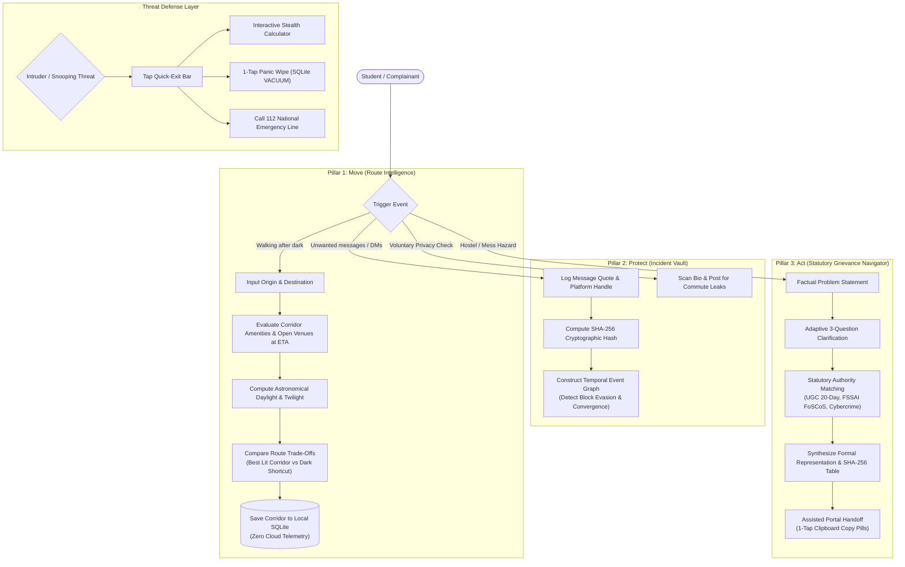
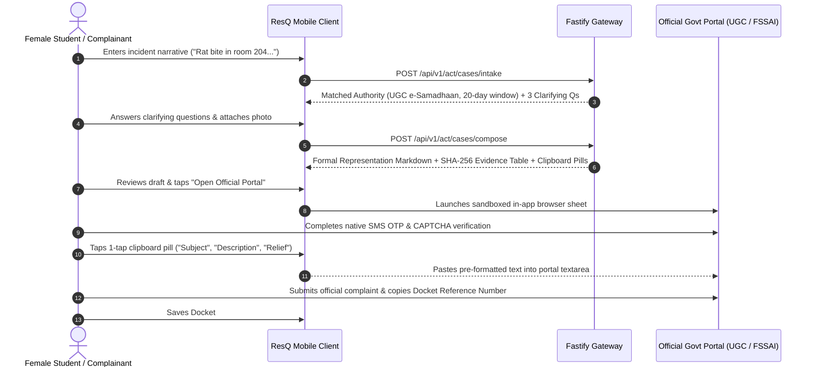
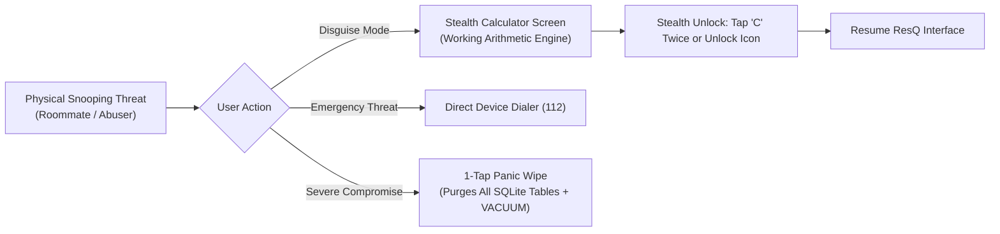
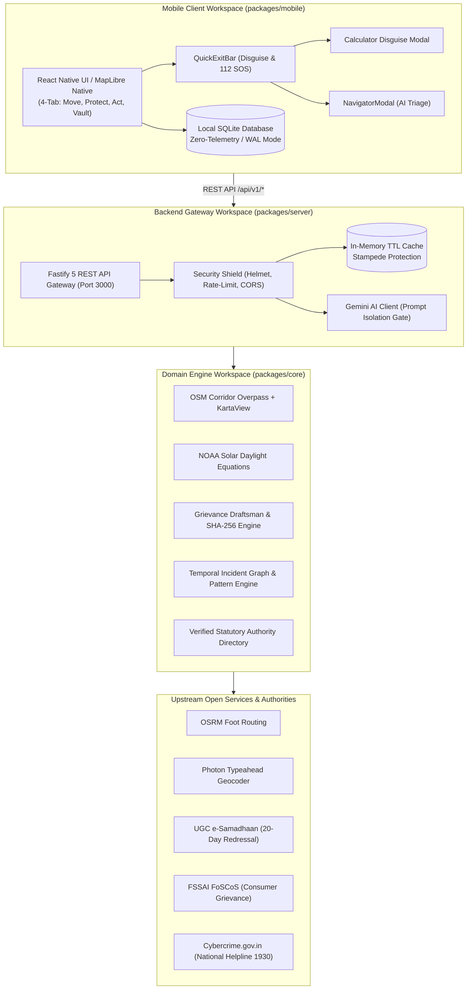

# ResQ — Unified Women's Safety & Action Platform
### *Move • Protect • Act*

> **An evidence-first, privacy-respecting platform combining explainable pedestrian route intelligence (Move), cross-platform digital harassment documentation (Protect), and statutory grievance escalation (Act).**

---

<p align="center">
  <a href="https://github.com/KatkamKoushik/ResQ/actions/workflows/ci.yml"></a>
  <a href="https://nodejs.org/api/test.html"></a>
  <a href="https://www.typescriptlang.org/"></a>
  <a href="https://fastify.dev/"></a>
  <a href="https://reactnative.dev/"></a>
  <a href="https://expo.dev/"></a>
</p>
<p align="center">
  
  
  
  
  <a href="LICENSE"></a>
</p>

---

## 1. Executive Summary & Vision Hook

Women and female university students in India navigate three interconnected safety realities that legacy applications treat in isolation:

1. **Uncertain Night Commute:** Walking back from campus laboratories or libraries after dark, where commercial navigation applications push pedestrians through unlit, isolated alleys solely to save 60 seconds.
2. **Persistent Online Harassment:** Cross-platform cyberstalking and unwanted contacts across Instagram, WhatsApp, and Telegram, where blocked accounts are repeatedly reconstituted and personal daily schedules are accidentally exposed via public social profiles.
3. **Hazardous Living Conditions & Institutional Inaction:** Severe hostel hazards (rodent infestations, room bites, contaminated mess food, broken door locks) met with administrative inaction, leaving students unsure how to legally escalate complaints under Indian statutory frameworks.

**`ResQ`** unifies these three domains into a single, cohesive, client-first architecture. It rejects manufactured, unscientific "safety scores", automated government portal spam bots, and false guarantees. Instead, it provides verifiable data, cryptographic proof preservation, and an intelligent navigator for statutory rights enforcement.

---

## 2. End-to-End User Experience Workflow



---

## 3. The Three Core Pillars

### Module A — Move (Route Intelligence)
* **Decoupled Information Coverage Scoring:** Mapped data availability (amenities, street-level photography) is mathematically decoupled from astronomical daylight. Solar conditions are reported separately under `walkingConditions`. A route receives identical coverage whether queried at noon or midnight.
* **Contextual Alternative Comparison:** Evaluates candidate walking corridors contextually using `rankAndCompareRouteAlternatives`, highlighting well-lit commercial streets over unlit shortcuts.
* **Corridor Imagery Sampling:** Multi-point polyline corridor sampling (start, midpoint, destination) rather than checking only the origin.
* **Honest Disclosures:** Explicitly discloses unverified crowd-sourced OpenStreetMap hours and empty default support registries.

### Module B — Protect (Incident Vault & Exposure Audit)
* **Cryptographic Incident Vault:** Each logged communication record receives a deterministic SHA-256 integrity hash for contemporaneous, tamper-evident evidence preservation.
* **Objective Behavioral Patterns:** Identifies escalating contact frequency, cross-platform convergence, and block evasion without making speculative legal accusations.
* **Voluntary Digital Exposure Auditor:** Client-side privacy auditor identifying accidental disclosures of hostel room numbers, daily commute schedules, or phone numbers in public social bios.

### Module C — Act (Statutory Grievance Assistant)
* **Verified Statutory Directory:** Grounded in statutory mandates for Indian higher education institutions:
  * **UGC e-Samadhaan (`samadhaan.ugc.ac.in`):** Enforces mandatory 20-working-day student grievance resolution.
  * **FSSAI FoSCoS (`foscos.fssai.gov.in`):** Mess food safety violations strictly requiring JPG/PNG photo attachments.
  * **National Cybercrime Reporting Portal (`cybercrime.gov.in`):** Cyberstalking and online threats with anonymous reporting options for women (Helpline: 1930).
  * **Internal Complaints Committee (ICC):** Campus harassment inquiries under the PoSH Act 2013 (90-day statutory resolution window).
  * **National Anti-Ragging Agency (`antiragging.in`):** 24/7 toll-free zero-tolerance escalation (1800-180-5522).
* **Formal Representation Generator:** Formats chronological statement of facts, statutory citations, prayers for relief, and a SHA-256 evidence annexures table.
* **Assisted Portal Handoff:** Replaces illegal headless bot scripts with 1-tap clipboard pills for rapid human entry onto official government portals.

---

## 4. Statutory Portal Handoff Architecture

Government portals strictly prohibit automated headless bots and require citizen CAPTCHA / OTP verification. `ResQ` bridges this through **Assisted Portal Handoff**:



---

## 5. Security, Privacy & Threat Defense Workflow



### Security & Privacy Commitments:
* **Zero Cloud Telemetry:** All routes, searches, incidents, and grievance drafts remain exclusively on the user's device in local SQLite storage.
* **1-Tap Hard Wipe:** Instant purge of all four local database tables (`saved_journeys`, `recent_searches`, `saved_incidents`, `saved_grievances`) followed by SQLite `VACUUM`.
* **Prompt-Injection Isolation:** AI pipelines treat all external text, extracted OCR, and document attachments strictly as *untrusted data strings*, preventing jailbreaks or instruction manipulation.
* **No Speculative Identity Claims:** ResQ Protect never claims `@user_x` on Instagram is the same physical individual as `@user_y` on WhatsApp without official police forensic subpoena.

---

## 6. System Monorepo Architecture



---

## 7. Repository Layout

```
d:\vyshu project\
├── packages/
│   ├── core/                    # Shared Domain Subsystem
│   │   ├── domain/
│   │   │   ├── authorityRegistry.js     # Directory of verified Indian statutory bodies
│   │   │   └── authorityRegistry.test.mjs
│   │   ├── providers/          # Overpass, OSRM, Panoramax, Mapillary clients
│   │   └── services/
│   │       ├── contextScoringService.js # Decoupled coverage scoring
│   │       ├── routeIntelligenceService.js # Alternative rankings & trade-offs
│   │       ├── grievanceDraftsman.js    # Formal petition & SHA-256 evidence
│   │       ├── protectEngine.js         # Temporal event graph & exposure audit
│   │       └── twilightService.js       # NOAA solar daylight math
│   ├── server/                  # Fastify Gateway Subsystem
│   │   └── src/
│   │       ├── routes/
│   │       │   ├── routingRoutes.ts     # Pedestrian route calculation
│   │       │   ├── contextRoutes.ts     # 120m corridor feature aggregation
│   │       │   ├── actRoutes.ts         # Case intake & formal draft composition
│   │       │   ├── protectRoutes.ts     # Timeline analysis & exposure audit
│   │       │   ├── navigatorRoutes.ts   # AI Safety Navigator triage & 112 filter
│   │       │   └── exportRoutes.ts      # Markdown & JSON evidence package export
│   │       └── services/
│   │           └── geminiClient.ts      # Gemini API client with prompt isolation
│   └── mobile/                  # React Native / Expo Frontend Subsystem
│       └── src/
│           ├── components/
│           │   ├── common/              # QuickExitBar, CalculatorModal, NavigatorModal
│           │   └── RouteComparisonCards.tsx
│           ├── screens/
│           │   ├── ExploreScreen.tsx    # Move: Pedestrian route context
│           │   ├── ProtectScreen.tsx    # Protect: Incident vault & exposure audit
│           │   ├── ActScreen.tsx        # Act: Statutory grievance wizard & handoff
│           │   └── SavedJourneysScreen.tsx # Vault: Offline corridors, incidents, cases
│           └── services/
│               └── storageService.ts    # Multi-table on-device SQLite storage
└── wiki/                        # Complete GitHub Wiki Documentation
```

---

## 8. Quick Start & Developer Guide

### Prerequisites
* Node.js v20+ (Node 22 or 24 LTS recommended)
* npm v10+

### Installation
```bash
git clone https://github.com/KatkamKoushik/ResQ.git resq
cd resq
npm install
```

### Running the Subsystems
```bash
# 1. Start the Fastify Gateway Backend (Port 3000)
npm run start:server
# Or start in development watch mode:
npm run dev:server

# 2. Start the Mobile Client
npm run --workspace=packages/mobile start
```

### Running the Verification Suite
```bash
# Run all 288 unit and integration tests across 54 suites
npm test

# Run TypeScript typechecks across all 3 workspaces
npm run typecheck

# Run ESLint across core and server
npm run lint
```

---

## 9. API Reference Summary

### Gateway Routes (`packages/server`)

| Method | Endpoint | Description |
| :--- | :--- | :--- |
| `GET` | `/health` | Service status, uptime, cache statistics, and memory telemetry |
| `POST` | `/api/v1/routes/pedestrian` | OSRM pedestrian routing with request deduplication |
| `POST` | `/api/v1/context/corridor` | Amenities within 120m polyline corridor via Overpass |
| `POST` | `/api/v1/navigator/triage` | Safety intent classification and emergency 112 trigger filter |
| `GET` | `/api/v1/act/authorities` | Verified Indian statutory grievance directory (legacy alias `/api/v1/herproof/authorities`) |
| `POST` | `/api/v1/act/cases/intake` | Case intake validation and 3 targeted clarifying questions (legacy alias `/api/v1/herproof/cases/intake`) |
| `POST` | `/api/v1/act/cases/compose` | Formal legal representation synthesizer with SHA-256 annexures (legacy alias `/api/v1/herproof/cases/compose`) |
| `POST` | `/api/v1/protect/analyze` | Temporal graph analysis and multi-channel pattern detection (legacy alias `/api/v1/stalkledger/analyze`) |
| `POST` | `/api/v1/protect/audit-exposure` | Social media bio and post privacy audit (legacy alias `/api/v1/stalkledger/audit-exposure`) |
| `POST` | `/api/v1/export/grievance-package` | Downloadable Markdown representation bundle with SHA-256 package checksum |
| `POST` | `/api/v1/export/incident-timeline` | Structured chronological incident manifest export |

---

## 10. Documentation & Wiki

* **GitHub Wiki:** Comprehensive architectural documentation, statutory references, and design specifications are in the [wiki/](file:///d:/vyshu%20project/wiki/) directory.
* **Code of Conduct:** [CODE_OF_CONDUCT.md](file:///d:/vyshu%20project/CODE_OF_CONDUCT.md)
* **Contributing Guidelines:** [CONTRIBUTING.md](file:///d:/vyshu%20project/CONTRIBUTING.md)
* **Security Policy:** [SECURITY.md](file:///d:/vyshu%20project/SECURITY.md)
* **Accessibility Statement:** [ACCESSIBILITY.md](file:///d:/vyshu%20project/ACCESSIBILITY.md)

---

## 11. Core Development Team

### Koushik Katkam
* **Email:** [koushikkatkam@gmail.com](mailto:koushikkatkam@gmail.com)
* **GitHub:** [KatkamKoushik](https://github.com/KatkamKoushik)
* **LinkedIn:** [koushik-katkam](https://linkedin.com/in/koushik-katkam)
* **Instagram:** [koushik_katkam](https://instagram.com/koushik_katkam)

### Vyshnavi Nagavelli
* **Email:** [nagavellivyshnavi3@gmail.com](mailto:nagavellivyshnavi3@gmail.com)
* **GitHub:** [nagavellivyshnavi](https://github.com/nagavellivyshnavi)
* **LinkedIn:** [vyshnavi-nagavelli-135465355](https://linkedin.com/in/vyshnavi-nagavelli-135465355/)

---

## 12. Attribution & License

This project is licensed under the [MIT License](LICENSE).
OpenStreetMap data is copyright OpenStreetMap contributors and licensed under the Open Database License (ODbL). Street-level photos are licensed under Creative Commons Attribution-ShareAlike 4.0 International (CC-BY-SA 4.0). Daylight calculations derived from NOAA solar position formulas.
