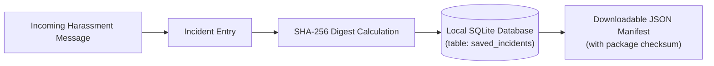
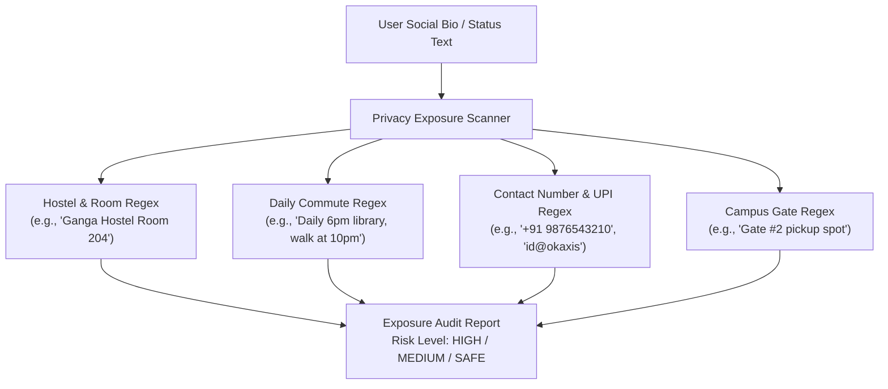

# Module B — Protect (Incident Vault & Exposure Audit)

## Overview

**Protect** is an evidence preservation vault and digital exposure auditor designed to document cross-platform harassment and eliminate inadvertent personal exposure.

---

## 1. Contemporaneous Evidence Vault with SHA-256 Hashes

When a user receives unwanted communications across multiple social platforms (Instagram, WhatsApp, Telegram, SMS, phone calls), ResQ logs each incident locally with contemporaneous metadata:

* Incident ID & ISO 8601 Timestamp
* Platform name
* Sender handle or phone number
* Verbatim message quote or call log details
* Prior block status (`wasBlockedPrior: true/false`)
* **SHA-256 Checksum:** Deterministically computed from the normalized record payload. Ensures that the record cannot be altered without changing its cryptographic checksum.

---

## 2. Objective Temporal Event Graph

The analytical engine (`protectEngine.js`) constructs an ordered temporal graph and identifies objective behavioral patterns:

| Pattern Type | Detection Criteria | Objective Summary |
| :--- | :--- | :--- |
| `BLOCK_EVASION` | An incident occurs after the user has explicitly blocked a prior account or number. | *"Persistent communication recorded following explicit blocking action."* |
| `CROSS_PLATFORM_CONVERGENCE` | Communications occur across $\ge 2$ distinct platforms within a correlated timeframe. | *"Multi-channel contact spanning multiple independent digital platforms."* |
| `OFF_HOURS_CONTACT` | Communications received between 11:00 PM and 5:00 AM. | *"Repeated nighttime contact outside customary hours."* |
| `ESCALATING_FREQUENCY` | $\ge 3$ communications recorded within a 48-hour window. | *"High-density communication cluster (3+ incidents in 48 hours)."* |
| `LOCATION_AWARENESS` | Messages referencing campus gates, hostel wings, or room numbers. | *"Communications reference physical campus, residential, or routine locations."* |

### Ethical & Legal Guardrail
ResQ strictly reports **objective factual patterns**. It never asserts criminal guilt or claims that two distinct handles belong to the same physical individual without law enforcement forensic proof.

---

## 3. Voluntary Digital Exposure Auditor

Many individuals accidentally reveal personal routines in public social media bios, statuses, or captions. The client-side Exposure Auditor scans user-supplied text for specific vulnerability vectors:

* **Remediation Advice:** Provides specific, actionable guidance (e.g., *"Remove specific room numbers; avoid posting recurring solitary study hours in public bios"*).

