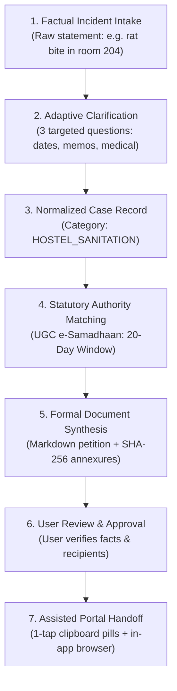
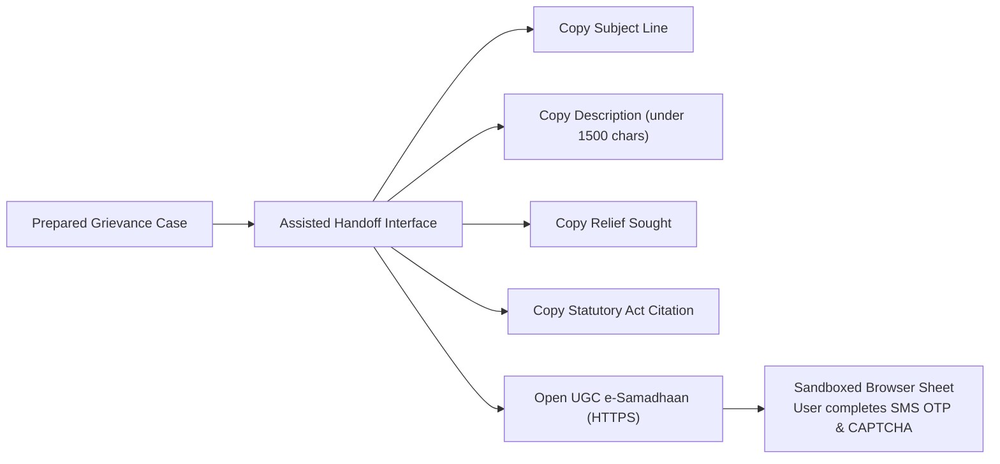

# Module C — Act (Statutory Grievance Assistant)

## Overview

**Act** is an evidence-to-action navigator designed to transform raw incident narratives into legally structured formal representations, match official statutory authorities in India, and provide Assisted Portal Handoff.

---

## 1. 7-Step Evidence-to-Action Pipeline

---

## 2. Dynamic 3-Question Clarification Engine

When a student enters a grievance, the system identifies missing critical facts needed for administrative and statutory review:

1. **Chronological Timestamps:** Establishing the exact date, time, and room number of the incident.
2. **Prior Administrative Inaction:** Documenting verbal and written memos sent to wardens or deans to prove institutional negligence.
3. **Medical & Physical Consequences:** Documenting clinic visits, doctor prescriptions, anti-rabies/tetanus vaccines, or safety hazards.

---

## 3. Formal Representation Structure

The generated representation adheres to formal administrative standards:
* **Subject Line:** Standardized formal title citing the location and category.
* **To Header:** Presiding Redressal Officer / Authority.
* **Section 1: Factual Chronology:** Objective, non-inflammatory statement of facts.
* **Section 2: Prior Internal Intimations:** Proof that internal remedies were exhausted without timely remediation.
* **Section 3: Statutory & Regulatory Framework:** Formal citation of governing regulations (e.g., UGC Student Grievance Regulations 2023).
* **Section 4: Specific Prayers for Relief:** Concrete, time-bound remedies requested (pest fumigation, mesh repair, medical reimbursement).
* **Section 5: Cryptographic Annexures Table:** List of attached photos and slips with individual 64-character SHA-256 hashes.

---

## 4. Assisted Portal Handoff Interface

* **Attachment Format Validation:** Warns the user if an uploaded document does not match the destination portal's strict rules (e.g. FSSAI FoSCoS strictly rejects PDF files and requires JPG/PNG images).

