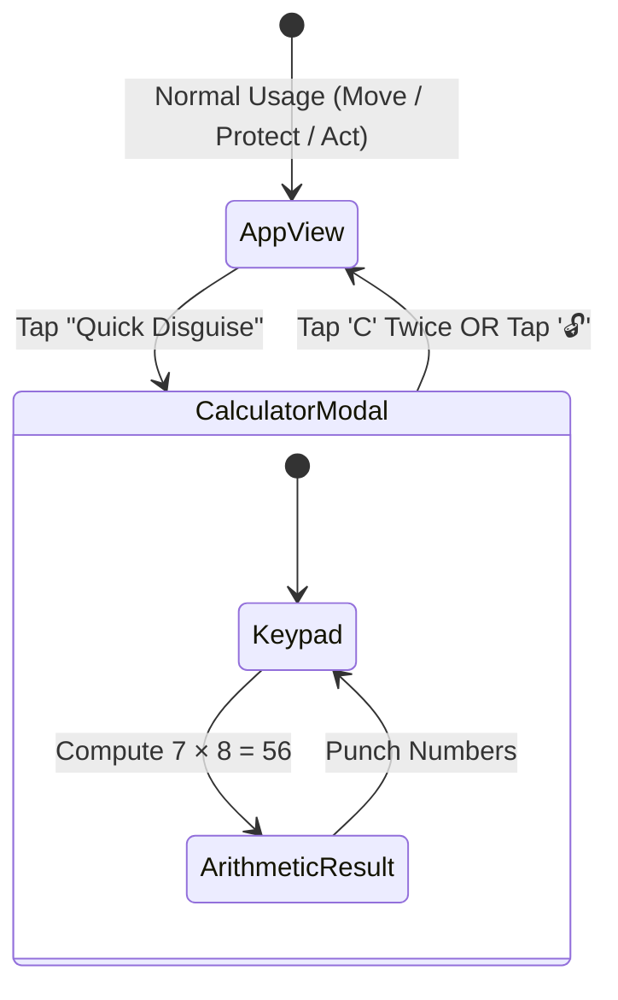
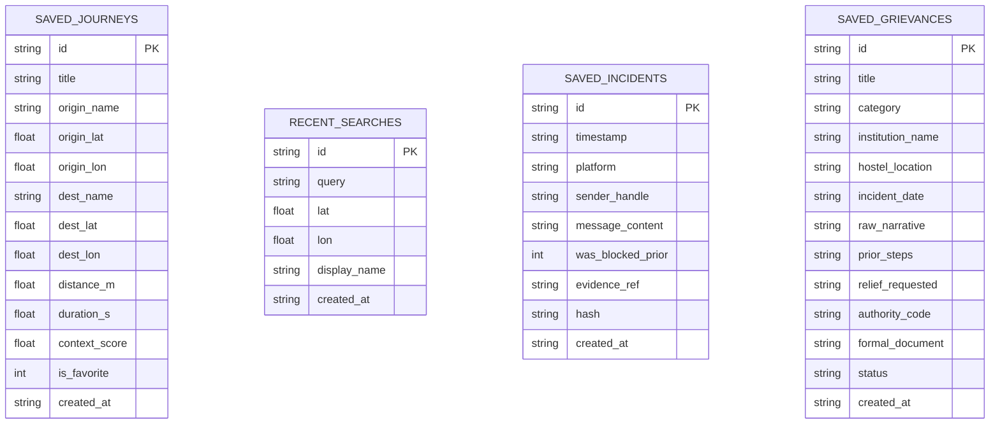

# Security, Privacy & Threat Defense Architecture

## Overview

The `ResQ` platform is built with a defense-in-depth security model specifically tailored to women experiencing digital surveillance, abusive roommates, or physical vulnerability.

---

## 1. Threat Model & Mitigations (STRIDE Framework)

```
┌───────────────────────────────────────┬────────────────────────────────────────────────────────┐
│ Threat Vector                         │ Architectural Defense                                  │
├───────────────────────────────────────┼────────────────────────────────────────────────────────┤
│ Snooping Roommate or Abusive Partner  │ Quick-Exit Bar: 1-Tap stealth Calculator Disguise      │
│ Device Inspection                     │ with working arithmetic keypad.                        │
├───────────────────────────────────────┼────────────────────────────────────────────────────────┤
│ Forensics Extraction via USB (ADB)    │ android:allowBackup="false" in AndroidManifest.xml;   │
│                                       │ SQLite database stored in private app sandbox.        │
├───────────────────────────────────────┼────────────────────────────────────────────────────────┤
│ Acute Personal Danger / Following     │ 112 Direct Device Dialer intent in header bar.         │
├───────────────────────────────────────┼────────────────────────────────────────────────────────┤
│ Evidence Destruction / Seizure Risk   │ 1-Tap Hard Wipe (Panic Wipe): Purges all SQLite tables │
│                                       │ (journeys, searches, incidents, cases) + VACUUM.       │
├───────────────────────────────────────┼────────────────────────────────────────────────────────┤
│ Tampering with Logged Evidence        │ Deterministic SHA-256 integrity hash calculated for    │
│                                       │ every contemporaneous incident and petition annexure.  │
├───────────────────────────────────────┼────────────────────────────────────────────────────────┤
│ Prompt Injection inside Screenshots   │ System guardrail treats all OCR and user text strictly │
│ or Uploaded Letters                   │ as UNTRUSTED DATA STRINGS.                             │
└───────────────────────────────────────┴────────────────────────────────────────────────────────┘
```

---

## 2. Interactive Calculator Disguise Architecture

When a user taps **Quick Disguise (🧮)** on the top bar:
1. The app immediately renders a full-screen, native modal replacing all safety, map, and grievance views.
2. The modal functions as a genuine standard calculator with arithmetic operations (`+`, `-`, `×`, `÷`, `%`, `±`).
3. **Stealth Unlock Mechanism:**
   * Tapping the clear button `C` twice when the screen displays `0` unlocks the disguise and restores the application.
   * Alternatively, pressing the discreet unlock icon (`🔓`) restores the interface.



---

## 3. Local-First SQLite Database Schema

The database (`walking_companion.db`) is configured in write-ahead logging (`WAL`) mode with zero cloud telemetry:



* **1-Tap Hard Wipe (`hardWipeAllData()`):**
  Executes `DELETE FROM saved_journeys; DELETE FROM recent_searches; DELETE FROM saved_incidents; DELETE FROM saved_grievances; VACUUM;` to reclaim freed disk pages and eliminate residual SQLite remnants.

